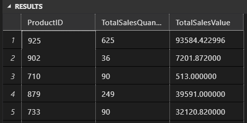
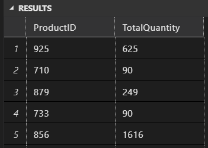
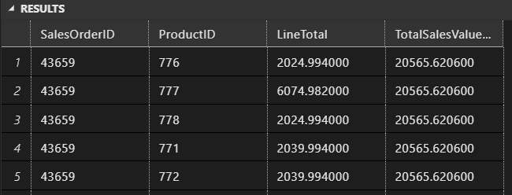
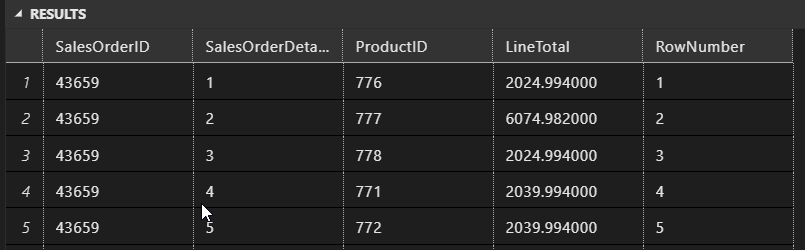
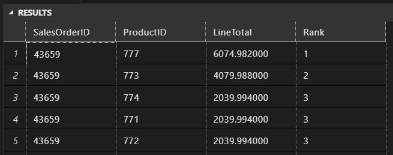
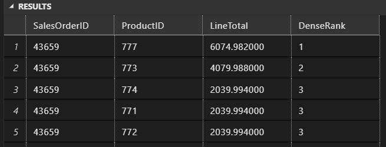
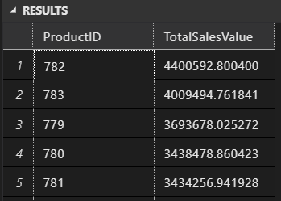

# Módulo 38: Agrupación y particionamiento — Solución

*Presenta: Juliho Castillo Colmenares*

Enunciado para estudiantes: [m38-agrupacion-y-particionamiento-guia.ipynb](m38-agrupacion-y-particionamiento-guia.ipynb) · Lección: [m38-agrupacion-y-particionamiento-leccion.ipynb](m38-agrupacion-y-particionamiento-leccion.ipynb)

## Contexto

El equipo comercial de AdventureWorks quiere saber qué productos se venden más y cuánto pesa cada línea dentro de su pedido. Para lo primero se **agrupan** las líneas de venta por producto; para lo segundo se **particiona** por pedido y se calcula, junto a cada línea, el total del pedido o la posición de la línea dentro de él. Todo se responde con la tabla `Sales.SalesOrderDetail` de la base `AdventureWorks2022` (`SalesOrderID`, `SalesOrderDetailID`, `ProductID`, `OrderQty`, `LineTotal`).

## Instrucciones

SQL Server con la base de ejemplo `AdventureWorks2022` restaurada; una consulta por tarea (archivos [consulta-01.sql](consulta-01.sql) a [consulta-07.sql](consulta-07.sql)).

1. **Totales por producto con `GROUP BY`:** unidades (`OrderQty`) y valor (`LineTotal`) vendidos por `ProductID`.
2. **Filtrar grupos con `HAVING`:** productos con más de 50 unidades vendidas.
3. **Total por pedido con `OVER (PARTITION BY ...)`:** total de `LineTotal` de cada `SalesOrderID` junto a cada línea.
4. **Numerar líneas con `ROW_NUMBER()`** dentro de cada `SalesOrderID`, por `SalesOrderDetailID`.
5. **Rangos con `RANK()`** por `LineTotal` descendente dentro de cada `SalesOrderID`.
6. **Rangos densos con `DENSE_RANK()`** por `LineTotal` descendente dentro de cada `SalesOrderID`.
7. **Filtrar y ordenar por valor de ventas:** productos con valor total superior a 5000, en orden descendente.

## Solución

Usa la base de datos `AdventureWorks2022` para completar los siguientes ejercicios. Cada ejercicio se basa en las lecciones que has visto en el curso. Asegúrate de seguir las instrucciones cuidadosamente y aplicar el tipo de unión adecuado para cada caso.

### Tarea 1. Totales por producto con `GROUP BY`

1. **Consulta con GROUP BY:**
   - Utiliza la tabla `Sales.SalesOrderDetail` para crear una consulta que obtenga el `ProductID`, el número total de ventas (`OrderQty`) y el valor total de ventas (`LineTotal`) por cada producto usando la cláusula `GROUP BY`.

   ```sql
   SELECT 
      ProductID, 
      SUM(OrderQty) AS TotalSalesQuantity, 
      SUM(LineTotal) AS TotalSalesValue
   FROM 
      [AdventureWorks2022].[Sales].[SalesOrderDetail]
   GROUP BY 
      ProductID;
   ```
   

### Tarea 2. Filtrar grupos con `HAVING`

2. **Filtrado con HAVING:**
   - Utiliza la tabla `Sales.SalesOrderDetail` para crear una consulta que agrupe los datos por `ProductID` y obtenga el número total de ventas (`OrderQty`) por producto. Filtra los grupos para mostrar solo aquellos productos que han tenido más de 50 ventas usando la cláusula `HAVING`.

   ```sql
   SELECT 
      ProductID, 
      SUM(OrderQty) AS TotalQuantity
   FROM 
      [AdventureWorks2022].[Sales].[SalesOrderDetail]
   GROUP BY 
      ProductID
   HAVING 
      SUM(OrderQty) > 50;
   ```
   

### Tarea 3. Total por pedido con `OVER (PARTITION BY ...)`

3. **Uso de OVER con PARTITION BY:**
   - Utiliza la tabla `Sales.SalesOrderDetail` para crear una consulta que muestre el `SalesOrderID`, `ProductID`, `LineTotal` y el valor total de ventas (`LineTotal`) para cada `SalesOrderID` usando la cláusula `OVER` con `PARTITION BY`.

   ```sql
   SELECT 
      SalesOrderID, 
      ProductID, 
      LineTotal, 
      SUM(LineTotal) OVER (PARTITION BY SalesOrderID) AS TotalSalesValuePerOrder
   FROM 
      [AdventureWorks2022].[Sales].[SalesOrderDetail];
   ```

   

### Tarea 4. Numerar líneas con `ROW_NUMBER()`

4. **Numeración con ROW_NUMBER():**
   - Utiliza la tabla `Sales.SalesOrderDetail` para crear una consulta que muestre el `SalesOrderID`, `SalesOrderDetailID`, `ProductID` y `LineTotal`. Usa la función `ROW_NUMBER()` para numerar cada línea de pedido dentro de cada `SalesOrderID`.

   ```sql
   SELECT 
      SalesOrderID, 
      SalesOrderDetailID, 
      ProductID, 
      LineTotal, 
      ROW_NUMBER() OVER (PARTITION BY SalesOrderID ORDER BY SalesOrderDetailID) AS RowNumber
   FROM 
      [AdventureWorks2022].[Sales].[SalesOrderDetail];
   ```

   

### Tarea 5. Rangos con `RANK()`

5. **Asignación de rangos con RANK():**
   - Utiliza la tabla `Sales.SalesOrderDetail` para crear una consulta que muestre el `SalesOrderID`, `ProductID` y `LineTotal`. Asigna un rango a cada producto dentro de cada `SalesOrderID` basado en el `LineTotal` usando la función `RANK()`.

   ```sql
   -- Utiliza la tabla Sales.SalesOrderDetail para crear una consulta que muestre el SalesOrderID, ProductID y LineTotal. Asigna un rango a cada producto dentro de cada SalesOrderID basado en el LineTotal usando la función RANK().

   SELECT 
      SalesOrderID, 
      ProductID, 
      LineTotal, 
      RANK() OVER (PARTITION BY SalesOrderID ORDER BY LineTotal DESC) AS Rank
   FROM 
      [AdventureWorks2022].[Sales].[SalesOrderDetail];
   ```

   

### Tarea 6. Rangos densos con `DENSE_RANK()`

6. **Asignación de rangos con DENSE_RANK():**
   - Utiliza la tabla `Sales.SalesOrderDetail` para crear una consulta que muestre el `SalesOrderID`, `ProductID` y `LineTotal`. Asigna un rango denso a cada producto dentro de cada `SalesOrderID` basado en el `LineTotal` usando la función `DENSE_RANK()`.

   ```sql
   -- Utiliza la tabla Sales.SalesOrderDetail para crear una consulta que muestre el SalesOrderID, ProductID y LineTotal. Asigna un rango denso a cada producto dentro de cada SalesOrderID basado en el LineTotal usando la función DENSE_RANK().

   SELECT 
      SalesOrderID, 
      ProductID, 
      LineTotal, 
      DENSE_RANK() OVER (PARTITION BY SalesOrderID ORDER BY LineTotal DESC) AS DenseRank
   FROM 
      [AdventureWorks2022].[Sales].[SalesOrderDetail];
   ```

   

### Tarea 7. Filtrar y ordenar por valor de ventas

7. **Filtrado con HAVING y ordenación:**
   - Utiliza la tabla `Sales.SalesOrderDetail` para crear una consulta que agrupe los datos por `ProductID` y obtenga el valor total de ventas (`LineTotal`). Filtra para mostrar solo aquellos productos con un valor total de ventas superior a $5000 usando la cláusula `HAVING`. Ordena los resultados por el valor total de ventas en orden descendente.

   ```sql
   SELECT 
      ProductID, 
      SUM(LineTotal) AS TotalSalesValue
   FROM 
      [AdventureWorks2022].[Sales].[SalesOrderDetail]
   GROUP BY 
      ProductID
   HAVING 
      SUM(LineTotal) > 5000
   ORDER BY 
      TotalSalesValue DESC;
   ```

   
