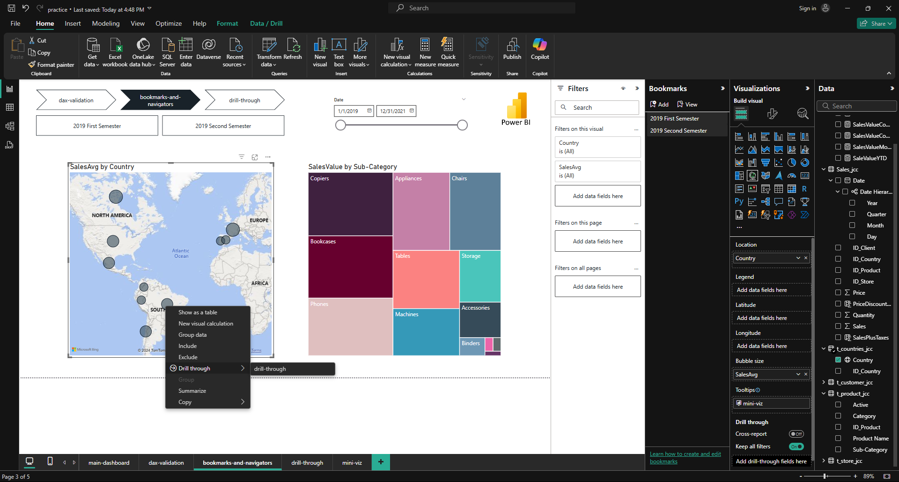

# Módulo 48: Objetos dinámicos

Autor: Juliho Castillo Colmenares

> Lección complementaria del ejercicio [m48-objetos-dinamicos-solucion.md](m48-objetos-dinamicos-solucion.md). No es una tarea entregada del programa.

Un informe estático responde las preguntas que su autor previó. Un informe **interactivo** deja que el lector haga las suyas: elegir un país, acotar un rango de fechas, pasar el cursor sobre un punto del mapa para ver el detalle o saltar a una página con la ficha completa de un producto. Power BI ofrece varias herramientas para eso, y esta lección explica cuándo usar cada una, con el modelo de ventas de la práctica.

1. Segmentadores
2. Interacciones entre objetos visuales
3. Jerarquías y explorar en profundidad
4. Obtención de detalles
5. Páginas de información sobre herramientas
6. Explorar en profundidad frente a obtener detalles
7. Errores frecuentes
8. Ejercicio

## 1. Segmentadores

Un **segmentador** (slicer) es un objeto visual cuyo único propósito es filtrar. A diferencia del panel **Filtros**, está a la vista del lector y deja claro qué selección está activa. Su estilo se cambia en **Formato del objeto visual → Configuración de la segmentación**:

| Estilo | Campo típico | Cuándo usarlo |
| --- | --- | --- |
| Lista vertical | `t_countries[Country]` (10 valores) | Pocas opciones que conviene ver todas a la vez |
| Lista desplegable | `t_product[Sub-Category]` | Muchas opciones o poco espacio |
| Mosaico | `t_product[Category]` (3 valores) | Muy pocas opciones; se ven como botones |
| Entre (rango) | `Calendario[Date]` | Fechas o números continuos; muestra un control deslizante y dos cajas de fecha |
| Relativo | `Calendario[Date]` | "Últimos 3 meses", "este año": el rango se mueve con la fecha actual |

En la configuración de selección se elige si se admite **selección única** o múltiple (con Ctrl), y si aparece la opción **Seleccionar todo**.

Un segmentador filtra por defecto todos los visuales de su página. Para que la misma selección se aplique en varias páginas se usa **Vista → Sincronizar segmentaciones** (Sync slicers), que permite marcar en qué páginas está visible el segmentador y en cuáles filtra.

El segmentador de rango sobre el calendario es especialmente útil con los datos de ventas, que cubren del 1 de enero de 2019 al 31 de diciembre de 2021: el lector puede acotar a un trimestre sin que el autor haya creado un filtro para cada uno.

## 2. Interacciones entre objetos visuales

En Power BI, al hacer clic en un elemento de un visual, los demás visuales de la página reaccionan. Al seleccionar "Technology" en una dona por categoría, el mapa y la tabla se actualizan. Esa reacción se configura con **Formato → Editar interacciones** (Edit interactions): al seleccionar un visual, los demás muestran tres iconos:

| Icono | Comportamiento | Ejemplo |
| --- | --- | --- |
| **Filtrar** | El otro visual muestra solo los datos seleccionados | La tabla por país pasa a mostrar solo ventas de Technology |
| **Resaltar** | El otro visual muestra el total en tono claro y la parte seleccionada en tono fuerte | Las columnas por mes muestran qué parte de cada mes es Technology |
| **Ninguno** | El otro visual no cambia | Una tarjeta con el total general que debe quedarse fija |

Resaltar es el valor por defecto en gráficos de barras y columnas, y suele ser el más informativo: muestra la parte sin perder de vista el todo. **Ninguno** es útil para visuales de referencia, como un KPI de contexto o un segmentador que no debe reducir sus opciones.

## 3. Jerarquías y explorar en profundidad

Una **jerarquía** es una lista ordenada de columnas que van de lo general a lo particular. Power BI crea automáticamente la jerarquía de fecha (Año → Trimestre → Mes → Día) cuando está activa la fecha automática. Para crear una propia, en el panel **Datos**, clic derecho sobre un campo → **Crear jerarquía**, y se arrastran los demás campos dentro:

```text
Jerarquía de producto (en t_product)
├── Category         (3 valores: Furniture, Office Supplies, Technology)
├── Sub-Category     (13 valores: Chairs, Tables, Copiers, Phones...)
└── Product Name     (1000 productos)
```

Al colocar la jerarquía en el eje de un gráfico, aparecen en la cabecera del visual unas flechas para **explorar en profundidad** (drill down):

| Acción | Qué hace |
| --- | --- |
| Activar la exploración y hacer clic en una barra | Baja un nivel **solo** para ese elemento: de Furniture a sus subcategorías |
| Ir al siguiente nivel | Cambia todo el eje al nivel siguiente: todas las subcategorías |
| Expandir un nivel | Muestra ambos niveles a la vez: "Furniture Chairs", "Furniture Tables"... |
| Explorar en sentido ascendente | Vuelve al nivel anterior |

Explorar en profundidad mantiene al lector **en el mismo visual**: es la herramienta para navegar categorías sin cambiar de página.

## 4. Obtención de detalles

La **obtención de detalles** (drill through) lleva al lector a **otra página** filtrada por el elemento en el que hizo clic. Es la herramienta para fichas de detalle: el informe principal muestra todos los países, y una página aparte muestra todo sobre uno solo.

Para crearla:

1. Crear una página nueva, por ejemplo "Detalle de país".
2. En el panel **Visualizaciones**, en la sección **Obtención de detalles** (Drill through), arrastrar el campo que define el detalle: `t_countries[Country]`.
3. Diseñar la página con los visuales del detalle: tendencia mensual, ventas por categoría, mejores tiendas.

Power BI agrega automáticamente un **botón Atrás** en la esquina superior izquierda de la página. En el escritorio se usa con Ctrl + clic; en el informe publicado, con un clic.

Desde cualquier visual que tenga `Country`, el lector hace clic derecho sobre un país → **Obtener detalles** → "Detalle de país", y llega a la página filtrada por ese país.



En la misma sección hay dos opciones:

| Opción | Qué controla |
| --- | --- |
| **Mantener todos los filtros** (Keep all filters) | Si está activada, la página de detalle hereda **todos** los filtros del visual de origen (segmentadores, filtros de página, otros campos), no solo el país. Si el lector había filtrado 2021, el detalle también será de 2021 |
| **Informe cruzado** (Cross-report) | Permite llegar a la página desde otros informes publicados en la misma área de trabajo |

Se pueden poner varios campos de obtención de detalles en cascada. Una página con `Country`, `Category`, `Sub-Category` y `Product Name` recibe los filtros que tenga el punto de origen en cada uno de esos campos.

## 5. Páginas de información sobre herramientas

La **información sobre herramientas** (tooltip) es la ventana que aparece al pasar el cursor sobre un elemento. La predeterminada muestra los campos del visual en texto. Una **página de información sobre herramientas** la sustituye por una página pequeña con sus propios visuales: un mini gráfico de tendencia o una dona dentro del tooltip.

Pasos para crearla:

1. Crear una página nueva y, en **Formato de página → Información de página**, activar **Permitir el uso como información sobre herramientas**.
2. En **Configuración del lienzo**, elegir el tipo **Información sobre herramientas**, que fija un tamaño pequeño (320 × 240 píxeles). Un lienzo grande se verá diminuto y aplastado.
3. Diseñar uno o dos visuales sencillos, sin títulos largos ni segmentadores.
4. En el visual de destino, en la configuración de la información sobre herramientas, elegir el tipo **Página de informe** y seleccionar la página creada.


La página se filtra con el contexto del punto bajo el cursor: si el cursor está sobre CANADA, el mini gráfico muestra las ventas de Canadá por año (2 376.8 M en 2019, 856.2 M en 2020 y 3 450.5 M en 2021).

Una buena página de información sobre herramientas responde una sola pregunta de seguimiento, la que el lector se hace al ver el punto: "¿y cómo ha evolucionado?", "¿de qué categorías se compone?".

## 6. Explorar en profundidad frente a obtener detalles

Los dos nombres se parecen, pero resuelven problemas diferentes:

| | Explorar en profundidad (drill down) | Obtención de detalles (drill through) |
| --- | --- | --- |
| Dónde ocurre | En el mismo visual | En otra página |
| Qué cambia | El nivel de la jerarquía en el eje | Toda la página, filtrada por el elemento |
| Requiere | Una jerarquía en el eje | Campos de obtención de detalles en la página destino |
| Cómo se activa | Flechas de la cabecera del visual | Clic derecho → Obtener detalles |
| Pregunta típica | "¿Qué subcategorías hay dentro de Furniture?" | "Muéstrame todo sobre Canadá" |

Y la información sobre herramientas completa el trío: responde una pregunta rápida **sin** salir de la vista actual.

## 7. Errores frecuentes

**Segmentadores que filtran visuales que deberían quedar fijos.** Una tarjeta con "Ventas totales del periodo" que cambia al seleccionar un país deja de ser una referencia. Se corrige con **Editar interacciones**, poniendo esa tarjeta en **Ninguno** respecto al segmentador.

**Página de obtención de detalles con un campo de otra tabla.** Si la página de detalle usa `Sales[ID_Country]` y el mapa muestra `t_countries[Country]`, la opción **Obtener detalles** no aparece en el menú, porque el visual de origen debe contener el campo de obtención de detalles. Conviene usar siempre los campos de las dimensiones, tanto en la página de detalle como en los visuales de origen.

**Olvidar "Mantener todos los filtros" o activarlo sin querer.** Si el lector filtró 2021 y la página de detalle muestra 2019–2021, el detalle contradice lo que veía. Al revés, si se mantiene todo, un filtro olvidado en otra parte del informe puede vaciar el detalle. Se decide caso por caso y se muestra en la página qué filtros llegan, por ejemplo con un título dinámico.

**Página de tooltip con el tamaño de lienzo por defecto.** Con 16:9 la página se reduce al tamaño del tooltip y todo queda ilegible. El lienzo debe ser de tipo información sobre herramientas o de un tamaño personalizado pequeño.

**Páginas auxiliares visibles en la navegación.** Las páginas de detalle y de tooltip no tienen sentido sin un filtro de origen. Se ocultan con clic derecho sobre la pestaña → **Ocultar página**, y siguen funcionando.

## 8. Ejercicio

Se quiere ampliar el informe de ventas con una ficha por tienda.

1. Crea una página "Detalle de tienda" con `t_store[Name_Store]` como campo de obtención de detalles.
2. Agrega un título dinámico que diga "Detalle de" y el nombre de la tienda seleccionada, o "varias tiendas" si llega más de una.
3. Incluye una tendencia mensual de ventas y una tabla por categoría.
4. Decide si conviene activar **Mantener todos los filtros** si en la página principal hay un segmentador de fechas.
5. Crea una página de información sobre herramientas que muestre, para la tienda bajo el cursor, su formato (`A`, `AA` o `AAA`) y sus ventas por año, y asígnala a un gráfico de barras por tienda.
6. Oculta las dos páginas auxiliares.

### Solución

Para los pasos 1, 3 y 6 basta con la interfaz, como en las secciones 4 y 5. El título dinámico del paso 2 es una medida que se muestra en una tarjeta o se asigna al título de un visual con **Formato condicional → Valor del campo**:

```dax
Título detalle tienda =
"Detalle de " & SELECTEDVALUE ( t_store[Name_Store], "varias tiendas" )
```

`SELECTEDVALUE` devuelve el valor de la columna si en el contexto hay exactamente uno, y el valor alternativo en otro caso.

Paso 4: sí conviene activarlo. Si el lector acotó el segmentador a 2020, la ficha de la tienda debe mostrar 2020; de lo contrario los números de la ficha no coincidirán con la barra en la que hizo clic. Para que quede claro, se puede añadir otra medida con el periodo recibido:

```dax
Periodo del detalle =
FORMAT ( MIN ( Calendario[Date] ), "dd/mm/yyyy" )
    & " – "
    & FORMAT ( MAX ( Calendario[Date] ), "dd/mm/yyyy" )
```

Paso 5: la página de información sobre herramientas, con lienzo de tipo información sobre herramientas, contiene una tarjeta con esta medida y un gráfico de columnas de `Ventas` por `Calendario[Año]`:

```dax
Formato tienda =
"Formato " & SELECTEDVALUE ( t_store[Format], "—" )
```

Resultado esperado al pasar el cursor por la barra de una tienda de formato `AAA`:

| Elemento del tooltip | Contenido |
| --- | --- |
| Tarjeta | Formato AAA |
| Columnas | Ventas de esa tienda en 2019, 2020 y 2021 |

## Resumen

- Los segmentadores filtran a la vista del lector; el estilo (lista, desplegable, rango, relativo) depende del campo, y se pueden sincronizar entre páginas.
- **Editar interacciones** decide si cada visual se filtra, se resalta o se queda fijo al seleccionar en otro.
- Las jerarquías permiten explorar en profundidad dentro del mismo visual.
- La obtención de detalles lleva a otra página filtrada; **Mantener todos los filtros** decide si hereda todo el contexto de origen.
- Las páginas de información sobre herramientas, con lienzo pequeño, muestran mini visuales al pasar el cursor.

En el **Módulo 49** se aplican principios de diseño al dashboard y se agregan marcadores, botones y navegación entre páginas.
