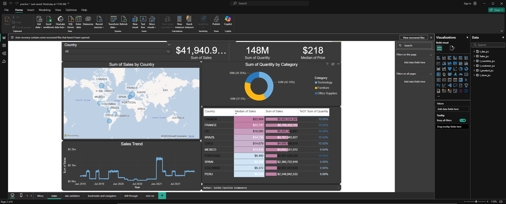

# Módulo 49: Diseño de dashboards

Autor: Juliho Castillo Colmenares

> Lección complementaria del ejercicio [m49-diseno-de-dashboards-solucion.pdf](m49-diseno-de-dashboards-solucion.pdf). No es una tarea entregada del programa.

Con los módulos anteriores ya podemos limpiar datos, modelarlos, calcular medidas y hacer visuales interactivos. Falta lo que decide si alguien usará el informe: que se entienda. Un dashboard compite por unos segundos de atención, y en ese tiempo el lector tiene que encontrar la respuesta a su pregunta. Esta lección reúne los principios de diseño y las herramientas de Power BI para organizar páginas, guiar la navegación y mantener un estilo coherente.

1. Principios de diseño
2. Elegir el objeto visual
3. Temas
4. Marcadores y el panel de selección
5. Navegadores de páginas y de marcadores
6. Botones y acciones
7. Diseño para móvil
8. Errores frecuentes
9. Ejercicio

## 1. Principios de diseño

**Jerarquía visual.** No todo pesa lo mismo. Lo más importante va arriba a la izquierda, que es donde empieza la lectura en idiomas occidentales, y en tamaño grande. Un patrón habitual en tres franjas:

| Franja | Contenido | Ejemplo con los datos de ventas |
| --- | --- | --- |
| Superior | KPI principales en tarjetas y segmentadores | Ventas totales (41 940.96 M), unidades (148 M), precio mediano |
| Central | El visual que responde la pregunta principal | Tendencia mensual de ventas 2019–2021 |
| Inferior | Desgloses y detalle | Ventas por país y por categoría |

**Regla de los 5 segundos.** Un lector que ve el dashboard por primera vez debería poder decir en cinco segundos de qué trata y cuál es el dato principal. Si necesita más, sobra algo o falta jerarquía.

**Cuadrícula y alineación.** Los visuales alineados a una cuadrícula común se perciben como un sistema; los desalineados por pocos píxeles, como un descuido. En **Vista** se activan **Líneas de cuadrícula** y **Ajustar a la cuadrícula**, y en **Formato → Alinear** se igualan bordes y espaciados entre visuales seleccionados.

**Consistencia.** El mismo color significa lo mismo en todas las páginas (si "Technology" es azul en la dona, es azul en las barras), los títulos tienen el mismo estilo y los números el mismo formato. La consistencia reduce lo que el lector tiene que aprender.

**Espacio en blanco.** El espacio vacío agrupa y separa. Llenar cada hueco con un visual más reduce la legibilidad de todos.



## 2. Elegir el objeto visual

La elección depende de la pregunta, no de la variedad:

| Pregunta | Objeto visual | Con los datos de ventas |
| --- | --- | --- |
| ¿Cuál es el valor clave? | Tarjeta / KPI | Ventas totales del periodo |
| ¿Cómo evoluciona en el tiempo? | Gráfico de líneas | Ventas por mes |
| ¿Cómo se comparan categorías? | Barras (horizontales si los nombres son largos) | Ventas por país, ordenadas |
| ¿Cómo se reparte un total en pocas partes? | Anillo o barras apiladas al 100 % | Ventas por las 3 categorías |
| ¿Cómo se reparte en muchas partes jerárquicas? | Mapa de árbol (treemap) | Ventas por subcategoría dentro de categoría |
| ¿Dónde ocurre? | Mapa | Ventas por país |
| ¿Cuáles son los valores exactos? | Tabla o matriz | Detalle por país con formato condicional |

Los anillos y los gráficos circulares funcionan con pocas partes (tres categorías: Technology 42 %, Furniture 38 %, Office Supplies 20 %). Con trece subcategorías, las porciones pequeñas se vuelven indistinguibles; un mapa de árbol o unas barras ordenadas comunican mejor.

## 3. Temas

Un **tema** (theme) define los colores, fuentes y estilos por defecto de todo el informe. Se elige en **Vista → Temas**: hay temas integrados, y la opción **Examinar temas** carga un archivo JSON propio. Con un tema, la consistencia del principio anterior es automática.

Un tema mínimo en JSON:

```json
{
  "name": "Ventas sobrio",
  "dataColors": ["#1F4E79", "#F28E2B", "#4E79A7", "#76B7B2", "#59A14F", "#EDC948"],
  "background": "#FFFFFF",
  "foreground": "#252423",
  "tableAccent": "#1F4E79"
}
```

| Clave | Efecto |
| --- | --- |
| `name` | Nombre del tema |
| `dataColors` | Paleta en orden: la primera serie usa el primer color, la segunda el segundo... |
| `background` / `foreground` | Colores de fondo y de texto principal |
| `tableAccent` | Color de acento de tablas y matrices |

El archivo admite muchas más claves, hasta el formato de cada tipo de visual, pero un tema pequeño ya resuelve la mayor parte. También se puede partir de un tema integrado, ajustarlo con **Personalizar tema actual** y exportarlo como JSON para reutilizarlo en otros informes.

## 4. Marcadores y el panel de selección

Un **marcador** (bookmark) guarda el estado de una página para volver a él con un clic. Se crean en **Vista → Marcadores**, con el botón **Agregar**. Cada marcador puede guardar tres cosas, que se activan o desactivan desde su menú:

| Opción | Qué guarda | Si se desactiva |
| --- | --- | --- |
| **Datos** | Filtros, segmentadores, selección en visuales, orden, nivel de exploración | El marcador no cambia los filtros actuales |
| **Presentación** | Qué visuales están visibles u ocultos, resaltado | El marcador no cambia qué se ve |
| **Página actual** | La página en la que se creó | El marcador se aplica a la página donde esté el lector |

Además, el marcador puede aplicarse a **todos los objetos visuales** o solo a los **objetos visuales seleccionados** al crearlo.

El **panel de selección** (**Vista → Selección**) lista todos los objetos de la página. Permite mostrarlos u ocultarlos con el icono del ojo, cambiar el orden de capas y darles nombres claros. Combinado con marcadores con la opción **Presentación**, permite alternar entre vistas en el mismo espacio:

| Marcador | Gráfico de líneas | Tabla de detalle |
| --- | --- | --- |
| "Ver gráfico" | Visible | Oculta |
| "Ver tabla" | Oculto | Visible |

Si estos marcadores tienen la opción **Datos** desactivada, el lector cambia de vista sin perder los filtros que eligió.

## 5. Navegadores de páginas y de marcadores

Desde **Insertar → Botones → Navegador** se agregan dos tipos de navegador:

- **Navegador de páginas** (Page navigator): crea un botón por cada página visible del informe. Se actualiza solo al agregar, renombrar u ocultar páginas.
- **Navegador de marcadores** (Bookmark navigator): crea un botón por cada marcador de un **grupo de marcadores**. Para agrupar, en el panel **Marcadores** se seleccionan varios marcadores y se usa la opción **Agrupar**.

El botón de la página o el marcador activos se muestra con un estilo diferente (estado **seleccionado**), así que el lector siempre sabe dónde está. En el formato del navegador se configuran los estados predeterminado, al pasar el cursor, al presionar y seleccionado.

Las páginas auxiliares (obtención de detalles, información sobre herramientas) se ocultan para que no aparezcan en el navegador de páginas.

## 6. Botones y acciones

Un **botón** (Insertar → Botones) es un objeto con una **acción** asignada. En **Formato → Acción** se activa la acción y se elige el tipo:

| Tipo de acción | Qué hace | Uso típico |
| --- | --- | --- |
| Atrás | Vuelve a la página anterior | Páginas de detalle |
| Marcador | Aplica un marcador | Alternar vistas o restablecer filtros |
| Obtención de detalles | Lleva a una página de detalle con el contexto seleccionado | Botón "Ver ficha" en lugar del clic derecho |
| Navegación de página | Lleva a una página concreta | Menú de inicio |
| Dirección URL web | Abre un enlace | Documentación del informe |

Un caso útil es el botón **Restablecer filtros**: un marcador creado sin filtros, con la opción **Datos** activada, asignado a un botón. Un clic devuelve la página a su estado inicial.

En Power BI Desktop, los botones se activan con **Ctrl + clic** mientras se edita; en el informe publicado basta un clic.

## 7. Diseño para móvil

Un informe diseñado para pantalla 16:9 se ve diminuto en un teléfono. En **Vista → Diseño para móviles** (Mobile layout) se abre un lienzo vertical en el que se arrastran los visuales ya creados y se reorganizan en una columna. El diseño móvil no duplica el informe: reutiliza los mismos visuales con otra disposición, y la aplicación móvil de Power BI lo usa cuando existe.

Pautas para el lienzo móvil:

- Pocos visuales por pantalla, en orden de importancia: primero los KPI.
- Segmentadores en formato desplegable para ahorrar espacio.
- Evitar tablas anchas y mapas pequeños, difíciles de leer y de tocar.

## 8. Errores frecuentes

**Demasiados visuales en una página.** Doce gráficos del mismo tamaño no tienen jerarquía y obligan a leerlo todo. Lo correcto es elegir la pregunta principal de la página y repartir el resto en páginas de detalle o en páginas de información sobre herramientas.

**Colores sin significado.** Si cada visual usa la paleta en orden, "Technology" puede ser azul en una dona y naranja en una barra. Se fijan los colores por categoría en el tema o en el formato de cada visual, y se mantienen en todas las páginas.

**Marcadores que pisan los filtros del lector.** Un marcador para alternar entre gráfico y tabla creado con la opción **Datos** activada restaura también los filtros del momento en que se creó. El lector elige "CANADA", pulsa "Ver tabla" y el filtro desaparece. Para marcadores de presentación se desactiva **Datos**.

**Marcadores que se aplican a toda la página cuando solo deberían afectar a unos visuales.** Si el marcador oculta un gráfico pero se aplica a todos los visuales, también puede restaurar el estado de otros que el lector cambió. Para alternar dos objetos se seleccionan esos objetos y se usa la opción **objetos visuales seleccionados**.

**Elementos decorativos que compiten con los datos.** Fondos con imágenes, sombras intensas y bordes gruesos atraen la mirada antes que los números. El estilo debe ser discreto para que destaque el contenido.

**Diseñar solo para la pantalla del autor.** Un informe que se ve bien en un monitor grande puede cortar títulos en un portátil. Conviene revisar el informe con la opción de ajuste a página y, si se consultará en teléfonos, crear el diseño móvil.

## 9. Ejercicio

Una página de ventas tiene un gráfico de líneas de ventas mensuales y una tabla de ventas por país, que ocupan el mismo espacio. Además, el informe tiene tres páginas: "Resumen", "Países" y "Productos".

1. Usa el panel de selección para nombrar los dos objetos ("Gráfico tendencia" y "Tabla países") y colócalos uno encima del otro.
2. Crea los marcadores "Ver gráfico" y "Ver tabla" para alternar entre ambos sin modificar los filtros del lector. Indica qué opciones del marcador activas o desactivas.
3. Agrúpalos y agrega un navegador de marcadores con esos dos botones.
4. Crea un botón "Restablecer filtros".
5. Agrega un navegador de páginas que no muestre la página de detalle "Ficha país".
6. Escribe un tema JSON con una paleta azul–naranja y fondo blanco, y explica cómo aplicarlo.

### Solución

1. En **Vista → Selección**, doble clic sobre cada nombre para renombrarlo. Se igualan tamaño y posición desde **Formato → Alinear** o desde el panel de formato (tamaño y posición).
2. Configuración de los marcadores:

| Marcador | Gráfico tendencia | Tabla países | Datos | Presentación | Página actual | Aplicar a |
| --- | --- | --- | --- | --- | --- | --- |
| Ver gráfico | Visible | Oculta | Desactivado | Activado | Activado | Objetos visuales seleccionados (los dos) |
| Ver tabla | Oculto | Visible | Desactivado | Activado | Activado | Objetos visuales seleccionados (los dos) |

Con **Datos** desactivado el marcador no toca filtros ni segmentadores; aplicarlo solo a los dos objetos evita que restaure el estado del resto de la página.

3. En el panel **Marcadores**, seleccionar ambos con Ctrl y elegir **Agrupar** (por ejemplo, grupo "Vista"). Luego **Insertar → Botones → Navegador → Navegador de marcadores** y elegir el grupo "Vista" en su formato.
4. Quitar todos los filtros de la página, crear el marcador "Inicio" con **Datos** activado y aplicado a todos los objetos visuales, insertar un botón en blanco con el texto "Restablecer filtros" y asignarle la acción de tipo **Marcador** → "Inicio".
5. Clic derecho sobre la pestaña "Ficha país" → **Ocultar página**. Después **Insertar → Botones → Navegador → Navegador de páginas**: solo aparecen "Resumen", "Países" y "Productos".
6. Tema:

```json
{
  "name": "Azul naranja",
  "dataColors": ["#1F4E79", "#F28E2B", "#6BAED6", "#FDAE6B", "#08306B", "#A63603"],
  "background": "#FFFFFF",
  "foreground": "#1F1F1F",
  "tableAccent": "#1F4E79"
}
```

Se guarda como `azul-naranja.json` y se carga con **Vista → Temas → Examinar temas**. Los visuales que no tengan colores fijados a mano adoptan la paleta.

## Resumen

- Un buen dashboard tiene jerarquía visual, respeta una cuadrícula, es consistente y pasa la regla de los 5 segundos.
- El objeto visual se elige por la pregunta: líneas para el tiempo, barras para comparar, tarjetas para KPI, mapa de árbol para jerarquías con muchas partes.
- Un tema JSON fija paleta, fondo y fuentes para todo el informe.
- Los marcadores guardan datos, presentación y página actual; combinados con el panel de selección permiten alternar vistas.
- Los navegadores de páginas y de marcadores, y los botones con acciones, convierten el informe en una aplicación navegable; el diseño móvil lo adapta al teléfono.

En el **Módulo 50** se publica el informe en Power BI Service, se programa su actualización y se restringe el acceso a los datos con seguridad de nivel de fila.
